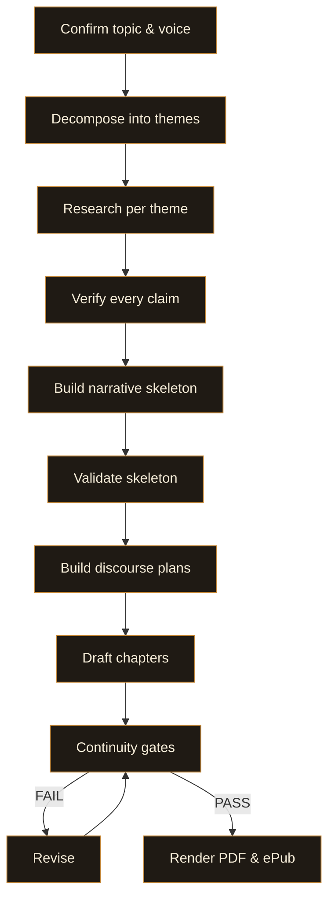

# book-maker

[](LICENSE)
[](#)

> Claim-verified. Narratively coherent. Books that feel like someone wrote them.

---

## Why I built this

I'd already built [deep-report](https://github.com/anthropics/deep-report) as a way to research topics I found interesting — a pipeline where I could explore something new and come back with a grounded, verified write-up. I really enjoyed that kind of learning content. But at some point I started asking: could I go further? Could I produce something book-length — something with an actual narrative arc, chapters that build on each other, a voice that doesn't read like it was generated?

The honest answer, at first, was no. Every attempt came out feeling the same. Same tonality. Same register. Same flat, analytical cadence that reads fine for a paragraph but becomes numbing across 200 pages. It felt AI-slopped — that specific quality where the words are competent but the writing has no weight to it. No texture. No moments where the author steps back and says something unexpected. I've seen this across a lot of skill-driven content generation, and I wanted to solve it.

So I spent time studying what actually makes a book feel like a book. Not just the prose — the typography, the editorial structure, the paragraph craft, the way a good non-fiction author like Atul Gawande or Richard Feynman breaks register to keep you reading. I looked at what publishers look for when they review manuscripts. I produced multiple iterations across different non-fiction modes — scientific, methodological, practical, personal — each one teaching me something the pipeline was missing.

What I landed on is a system with 33 style rules, 14 discourse principles, 15 adversarial continuity gates, a voice texture protocol, and an emotional accumulation architecture. Every claim is verified against primary sources. Every chapter gets a discourse brief before a single word is drafted. The narrative skeleton is built and validated before drafting begins. And at the end, a separate reviewer agent — one that never saw the drafting process — stress-tests the whole manuscript.

The result is something I'd genuinely consider picking up in a bookshop. That was the bar, and I think this gets there.

---

## Install

```bash
/install-plugin /path/to/book-maker
```

**Requirements on `PATH`:** `bash`, `weasyprint`, `python3`

**System dependencies (macOS):**

```bash
brew install pango cairo libffi gdk-pixbuf harfbuzz
brew install --cask font-eb-garamond
pip install weasyprint
```

Open a session. Say "write me a book about X" — or type `/book-maker` to start explicitly. The `UserPromptSubmit` hook detects book intent and kicks off the pipeline.

---

## The pipeline



| Stage | What happens | What you do |
|---|---|---|
| **Topic confirmation** | Lock the topic, voice anchor, book mode (narrative or research), and output format. | Confirm or adjust. |
| **Research decomposition** | Topic splits into research themes. One subagent per theme. | Watch it work. |
| **Claim verification** | Every load-bearing claim extracted to a ledger and verified against primary sources. | Nothing — unverified claims halt the pipeline. |
| **Narrative skeleton** | Spine (thesis + 5-beat arc), architecture (chapter skeleton), thread registry, transition contracts, concept cards, argument DAG. | Review if you want. |
| **Skeleton validation** | 6 pre-draft gates check structural integrity before a single word is drafted. | Fix what it flags. |
| **Discourse planning** | Per-chapter briefs encoding seven narrative craft principles. Each chapter knows its rhetorical job. | Watch it work. |
| **Chapter drafting** | Chapters drafted sequentially with discourse briefs as primary input, growing a bible as they go. | Watch it work. |
| **Continuity review** | 15 adversarial gates run by a separate reviewer agent that never saw the drafting process. | Fix what it flags, or the pipeline revises automatically. |
| **Rendering** | Styled HTML assembled with professional book typography, printed to PDF via WeasyPrint, packaged as ePub3. | Open the PDF. |

You approve at two gates: the topic, and the final output. Everything between is the pipeline doing its job.

---

## What makes it different

**Three-layer architecture.** Every book passes through fabula (what the argument says), discourse (how the story is told), and prose (the actual words). Most generation systems collapse these into one pass. Separating them is what gives chapters rhetorical intent instead of structural templates.

**33 style rules.** Seven voice bans, ten structure bans, six rhythm rules, five line-editing rules, two voice texture rules, two formatting rules, one deliberate imperfection rule. These aren't suggestions — they're hard constraints enforced during drafting.

**Voice texture protocol.** Dual perspective (Lopate/Silverman), five categories of register breaks, teacher's presence markers, narrator arc tracking. This is what stops the prose from settling into that flat analytical register that makes AI writing feel like AI writing.

**Emotional accumulation.** Leitmotifs that recur across chapters. Callbacks that harvest seeds planted earlier. Progressive stakes that escalate. A narrator whose stance transforms. Chapters don't just follow each other — they build.

**Claim verification.** Every load-bearing fact passes through a verification sidecar against primary sources before it reaches the final PDF. The pipeline halts on unverified claims. This isn't optional.

**No agent grades its own work.** The drafter and the continuity reviewer are separate agents with separate prompts. The reviewer sees only the manuscript, never the drafting reasoning. Same separation principle as [Fagan inspections](https://en.wikipedia.org/wiki/Fagan_inspection).

**Professional book typography.** 6x9 inch trim, EB Garamond, first-line indent (not block paragraphs), justified text with hyphenation, asymmetric margins with gutter, running headers (book title verso, chapter title recto), drop caps, chapter openers sunk 33%, PDF bookmarks, automatic TOC page numbers via CSS Paged Media Level 3.

---

## Output formats

| Format | Engine | Distribution |
|---|---|---|
| **PDF** | WeasyPrint (CSS Paged Media Level 3) | Print-on-demand, direct distribution |
| **ePub3** | ZIP assembly from same source | Amazon KDP, Apple Books, Kobo, Google Play |

Both formats are generated from the same chapter markdown — the rendering step is the only thing that diverges.

---

## Development iterations

The pipeline was refined across four test books, each covering a different non-fiction mode:

| Domain | Mode | Words | Chapters | Version |
|---|---|---|---|---|
| Scientific research | Technical explainer | 77,570 | 13 | v0.2 |
| Skill design & methodology | Meta-analytical | 78,059 | 12 | v0.3 |
| Career development | Practical guide | 60,706 | 10 | v0.4 |
| Personal narrative | Memoir | 24,930 | 11 | v0.5 |

Each iteration taught the pipeline something: v0.3 fixed paragraph density (78% over 100 words down to 20%), v0.4 fixed voice texture (uniform analytical register broken with non-fiction craft techniques), v0.5 added emotional accumulation (chapters that build on each other instead of reading like isolated sections).

---

## Verdict tokens

| Token | Meaning |
|---|---|
| `BOOK_SHIPPED` | PDF rendered, every claim verified, all continuity gates passed. |
| `CLAIMS_UNVERIFIED` | One or more load-bearing claims failed the verifier. |
| `NARRATIVE_BROKEN` | Continuity review failed after revision pass. |
| `SCOPE_TOO_VAGUE` | Topic was rejected at the confirmation step. |

---

## Project structure

```
skills/book-maker/
  SKILL.md                    # The pipeline — Claude Code is the executor
  agents/                     # Agent prompts (drafter, reviewer, architect, etc.)
  references/                 # Style rules, discourse protocol, continuity gates, render protocol
  schemas/                    # JSON schemas (spine, architecture, discourse brief, etc.)
  assets/
    print.css                 # Professional book interior (6x9, Garamond, paged media)
    epub.css                  # ePub-specific styling
    hedge-words.txt           # Banned hedge words list
```

The plugin is pure Markdown — no scripts. SKILL.md is the script, Claude Code is the executor, MD over JS.

---

## Tests

```bash
bash tests/run-tests.sh
```

Shell tests across hooks and intent detection.

---

## Licence

MIT. See [LICENSE](LICENSE). Use it. Fork it. Make books with it.
