# book-maker

<!-- design-region-clean-of-hard-gates -->

<HARD-GATE>
Do NOT proceed without an explicit topic, voice anchor, and book mode declared by the user. STOP and ask.
</HARD-GATE>

<HARD-GATE>
Do NOT begin chapter drafting until the narrative skeleton passes all pre-draft validation gates. STOP and fix the skeleton.
</HARD-GATE>

<HARD-GATE>
Do NOT begin chapter drafting until every load-bearing claim carries a verifier verdict. STOP and emit CLAIMS_UNVERIFIED.
</HARD-GATE>

<HARD-GATE>
Never draft chapters in parallel. STOP and draft sequentially so each chapter knows what came before.
</HARD-GATE>

<HARD-GATE>
Never emit a figure whose layout is scattered or free-form. STOP and re-spec as a structured layout.
</HARD-GATE>

<HARD-GATE>
Never invoke the Artifact tool. STOP and write output to the filesystem as PDF only.
</HARD-GATE>

<HARD-GATE>
Never produce the final PDF from a path other than rendered HTML. STOP and reroute through the HTML renderer.
</HARD-GATE>

<HARD-GATE>
Do NOT emit BOOK_SHIPPED unless every claim is verified, all 8 continuity gates pass, and the post-render verifier passes. STOP and emit the appropriate failure verdict.
</HARD-GATE>

## Anti-Pattern

**"I can write the chapters without building the narrative skeleton first, and the prose is fluent enough that the claims don't need independent verification."** Skipping the narrative skeleton produces paragraphs that feel like isolated report sections — each one self-contained, none flowing into the others, no story arc connecting chapters. Skipping claim verification produces confident hallucination that a reader cannot distinguish from grounded fact. Both are enforced: the skeleton must be built and validated before any chapter is drafted, and every load-bearing claim must pass the verification sidecar before it reaches the final PDF.

## Core Principle

Every book is a multi-agent pipeline where research claims are verified against sources, narrative structure is tracked in a living bible and adversarially checked for coherence, and chapters are drafted sequentially so each one builds on what came before.

## Process Flow

```dot
digraph book_maker {
    rankdir=TB;

    "Receive topic" [shape=box];
    "Confirm topic, voice, mode" [shape=box];
    "Topic actionable?" [shape=diamond];
    "SCOPE_TOO_VAGUE" [shape=doublecircle];

    "Decompose into themes" [shape=box];
    "Spawn per-theme researchers" [shape=box];
    "Extract claims" [shape=box];
    "Run claim verification" [shape=box];
    "All claims verified?" [shape=diamond];
    "CLAIMS_UNVERIFIED" [shape=doublecircle];

    "Build spine" [shape=box];
    "Build architecture + concepts + DAG" [shape=box];
    "Build thread registry" [shape=box];
    "Build transition contracts" [shape=box];
    "Validate skeleton" [shape=box];
    "Skeleton valid?" [shape=diamond];

    "Draft chapters sequentially" [shape=box];
    "Run 8 continuity gates" [shape=box];
    "All gates pass?" [shape=diamond];
    "Revise flagged chapters" [shape=box];
    "Gates pass after revision?" [shape=diamond];
    "NARRATIVE_BROKEN" [shape=doublecircle];

    "Assemble endnotes" [shape=box];
    "Spec and render figures" [shape=box];
    "Assemble HTML, print PDF" [shape=box];
    "Post-render verifier" [shape=box];
    "Post-render passes?" [shape=diamond];
    "BOOK_SHIPPED" [shape=doublecircle];

    "Receive topic" -> "Confirm topic, voice, mode";
    "Confirm topic, voice, mode" -> "Topic actionable?";
    "Topic actionable?" -> "SCOPE_TOO_VAGUE" [label="no"];
    "Topic actionable?" -> "Decompose into themes" [label="yes"];
    "Decompose into themes" -> "Spawn per-theme researchers";
    "Spawn per-theme researchers" -> "Extract claims";
    "Extract claims" -> "Run claim verification";
    "Run claim verification" -> "All claims verified?";
    "All claims verified?" -> "CLAIMS_UNVERIFIED" [label="no"];
    "All claims verified?" -> "Build spine" [label="yes"];
    "Build spine" -> "Build architecture + concepts + DAG";
    "Build architecture + concepts + DAG" -> "Build thread registry";
    "Build thread registry" -> "Build transition contracts";
    "Build transition contracts" -> "Validate skeleton";
    "Validate skeleton" -> "Skeleton valid?";
    "Skeleton valid?" -> "Build spine" [label="no, revise"];
    "Skeleton valid?" -> "Draft chapters sequentially" [label="yes"];
    "Draft chapters sequentially" -> "Run 8 continuity gates";
    "Run 8 continuity gates" -> "All gates pass?";
    "All gates pass?" -> "Assemble endnotes" [label="yes"];
    "All gates pass?" -> "Revise flagged chapters" [label="no"];
    "Revise flagged chapters" -> "Gates pass after revision?";
    "Gates pass after revision?" -> "Assemble endnotes" [label="yes"];
    "Gates pass after revision?" -> "NARRATIVE_BROKEN" [label="no"];
    "Assemble endnotes" -> "Spec and render figures";
    "Spec and render figures" -> "Assemble HTML, print PDF";
    "Assemble HTML, print PDF" -> "Post-render verifier";
    "Post-render verifier" -> "Post-render passes?";
    "Post-render passes?" -> "BOOK_SHIPPED" [label="yes"];
    "Post-render passes?" -> "Assemble HTML, print PDF" [label="no, fix"];
}
```



## Checklist

1. Confirm topic, voice anchor, and book mode with the user.
2. Decompose the topic into research themes.
3. Spawn one research subagent per theme and collect their markdown drafts.
4. Extract every load-bearing claim into a claims ledger and run the verification sidecar.
5. Build the narrative skeleton (spine, architecture, concepts, arguments, threads, transitions).
6. Validate the skeleton against 6 pre-draft gates.
7. Draft chapters sequentially, growing the bible during drafting.
8. Run the 8-gate continuity review with a separate agent.
9. Assemble per-chapter endnotes with clickable source URLs.
10. Spec, render, and measure figures.
11. Assemble the HTML document and print to PDF via headless browser.
12. Run the post-render verifier.
13. Emit the verdict token.

## Step Details

### 1. Confirm topic, voice anchor, and book mode

Ask one question at a time. Refuse to start while any of the three is unnamed. Voice anchor defaults to a calm, explainable, articulate technical lecturer; named anchors are available (read `references/voice-anchors.md`). Book modes: `narrative` (argument-driven, story arc, personal voice, 8-15 chapters across 3-5 parts) or `research` (evidence-driven, systematic, academic register, 10-20 chapters across 3-6 parts). The user optionally provides a narrative direction (thesis, chapter structure, story arc). If not provided, generate one from research findings.

### 2. Decompose the topic into research themes

Produce a flat list of 6-12 non-overlapping, independently researchable themes. Write to `book/themes.md`.

### 3. Spawn per-theme research subagents

One subagent per theme. Each writes to `book/research/<slug>.md` with inline `[source: <url>]` citations beside every factual claim. Subagents run in parallel. No speculation in research drafts.

### 4. Extract claims and run verification

Walk each theme markdown. A load-bearing claim is any specific fact a reader would carry away (names, numbers, dates, operators, causal links). Write `book/claims.jsonl` with one row per claim. The verification sidecar fetches each cited source and confirms the claim verbatim or in close paraphrase. Read `references/verifier-protocol.md` for source trust hierarchy and close-paraphrase rules. One corrective re-research pass allowed; any non-`verified` claim after the pass triggers `CLAIMS_UNVERIFIED`.

### 5. Build the narrative skeleton

Dispatch the narrative-architect subagent (`agents/narrative-architect.md`). The subagent runs with fresh context and reads the verified research drafts, claims ledger, voice anchor, book mode, and optional user narrative direction. It produces six JSON artifacts, each conforming to its schema:

- `book/spine.json` — thesis + 5-beat arc (conforming to `schemas/spine.schema.json`). If the user provided a narrative direction, build from that. Otherwise, generate from verified research.
- `book/architecture.json` — chapter skeleton with entry/exit beliefs, sections tagged with narrative functions (`orient`, `establish`, `complicate`, `evidence`, `synthesize`, `pivot`, `resolve`, `bridge`). Read `references/narrative-functions.md` for definitions. Conforming to `schemas/architecture.schema.json`.
- `book/concepts.json` — concept cards tracking first introduction, reinforcement, challenge, and `assumed_known_after` chapter. Conforming to `schemas/concept.schema.json`.
- `book/arguments.json` — argument dependency DAG. Conforming to `schemas/argument.schema.json`.
- `book/threads.jsonl` — one entry per narrative promise (question, concept, anecdote, tension, metaphor, case_study). Conforming to `schemas/thread.schema.json`.
- `book/transitions.json` — one entry per chapter boundary with exit_state, bridge_sentence, entry_assumption. Conforming to `schemas/transition.schema.json`.

### 6. Validate the skeleton

Run 6 pre-draft gates before any chapter is drafted:

- Concept ordering — no concept referenced before its `first_introduced` chapter.
- Argument DAG — topological sort confirms no circular dependencies and no dependency on a later chapter.
- Horizontal flow — chapter titles and central arguments read in sequence form a progressive argument.
- Transition coverage — every chapter pair has a transition contract.
- Thread seeding — at least 3 threads introduced in the first 25% of chapters.
- Claim coverage — every verified claim assigned to at least one chapter.

Revise the skeleton on any failure. Do not proceed to drafting.

### 7. Draft chapters sequentially

Dispatch the chapter-drafter subagent (`agents/chapter-drafter.md`) once per chapter, in order. Each dispatch receives the chapter's architecture entry, paths to all previously drafted chapters, the claims ledger, thread registry, transition contracts, voice anchor, and book mode. The subagent writes to `book/chapters/<chapter_id>.md` and updates `book/threads.jsonl` and `book/grid.json` (conforming to `schemas/grid.schema.json`).

Sequential drafting is mandatory — each chapter references what was established in prior chapters. During drafting: tag each section with polarity shift and turning point; update threads as introduced, developed, or resolved; write transitional bridges between paragraphs and sections.

Narrative mode: transitional bridges between paragraphs, at least one scene or anecdote per chapter, metaphors extended or called back, direct reader address permitted.

Research mode: every factual claim references a verified entry from claims.jsonl, minimum 3 cited claims per section, analytical voice maintained throughout.

### 8. Run the 8-gate continuity review

Dispatch the continuity-reviewer subagent (`agents/continuity-reviewer.md`) with fresh context and no drafting history. Read `references/continuity-gates.md` for gate specifications. The reviewer reads the full draft plus all bible artifacts and runs:

1. Thread completeness — flag orphan threads with `status: open`.
2. Horizontal flow — flag broken sequence points in chapter openings.
3. Transition audit — flag cold starts, orphan closes, logical gaps.
4. Concept ordering — flag forward-reference errors.
5. Pacing envelope — flag sagging middle, uniform lengths, flat density.
6. Redundancy detection — flag sections making same claim without adding depth.
7. Entity consistency — flag spelling inconsistencies, missing introductions.
8. Arc completeness — flag flatlined polarity sequences, missing turning point.

One revision pass allowed on flagged chapters. If gates still fail after revision, emit `NARRATIVE_BROKEN`.

### 9. Assemble endnotes

For each chapter: collect all `[source: <url>]` citations in order of appearance, assign sequential numbers starting from 1, replace inline citations with superscript numbers, generate an endnote section conforming to `schemas/endnote.schema.json` with full citation text and clickable source URL. Write to `book/endnotes/<chapter_id>.json`. Validate: every superscript has a matching endnote, every endnote has a matching superscript, every URL is a valid link.

### 10. Spec, render, and measure figures

Dispatch the figure-spec-author subagent (`agents/figure-spec-author.md`) per section that warrants a figure. Four permitted families: `hierarchy`, `sequence`, `matrix`, `table`. Read `references/figure-layouts.md` for family definitions and refused layouts. Render via `scripts/render-figure.js`, measure via `scripts/measure-figure.js`. A figure failing the gate goes back to the spec author for one corrective pass.

### 11. Assemble HTML and print to PDF

Assemble rendered chapters, endnotes, and figure HTML into a styled HTML document with: title page (title, subtitle, author, date), auto-generated table of contents with page numbers, part divider pages, chapter pages starting on new pages, per-chapter endnote sections, consolidated bibliography in back matter, page numbers. Inline `assets/print.css`. Print to PDF via headless browser gated on `document.fonts.ready`.

### 12. Run the post-render verifier

Run `scripts/verify-pdf.js`: figure-fit-content-width, WCAG AA text contrast, no-orphan-heading, no-blank-page. Book-specific checks: TOC page numbers match actual pages, every chapter starts on a new page, no endnote section is empty, part dividers occupy their own pages.

### 13. Emit the verdict token

`BOOK_SHIPPED` when every claim is verified, all 8 continuity gates pass, and the post-render verifier passes. `CLAIMS_UNVERIFIED` when any load-bearing claim failed verification. `NARRATIVE_BROKEN` when continuity review failed after revision pass. `SCOPE_TOO_VAGUE` when the topic was rejected at step 1.

## Gate Functions

- BEFORE spawning research subagents: "Has the user named topic, voice anchor, and book mode?"
- BEFORE building the narrative spine: "Does every load-bearing claim resolve to a `verified` verdict?"
- BEFORE beginning chapter drafting: "Did all 6 pre-draft skeleton validation gates pass?"
- BEFORE drafting chapter N+1: "Is chapter N fully drafted and its threads registered in the bible?"
- BEFORE accepting a figure spec: "Is this layout one of the four permitted families: hierarchy, sequence, matrix, or table?"
- BEFORE entering the HTML render: "Did all 8 continuity gates pass and are all endnotes assembled?"
- BEFORE emitting BOOK_SHIPPED: "Did the PDF originate exclusively from the HTML renderer, did every continuity gate pass, and is every claim verified?"
- BEFORE invoking any output tool: "Am I about to invoke the Artifact tool?"

## Rationalization Table

| You think... | Reality |
|---|---|
| "The research is done, I can start writing chapters now" | Write the full skeleton first. Skeleton-less drafting produces report sections, not book chapters. |
| "The chapters flow well enough without transition contracts" | Write explicit exit_state/entry_assumption pairs. This is exactly the failure mode of deep-report. |
| "I can draft chapters in parallel to save time" | Draft chapters sequentially. Each one must know what came before. |
| "Claim verification is overkill for a narrative book" | Verify every claim regardless of mode. Fluent hallucination is worse than clumsy truth. |
| "The thread registry is unnecessary overhead" | Log every thread in the registry. Untracked threads become orphan promises the reader never forgets. |
| "I can fix the transitions in a polish pass" | Write transitions into the skeleton before drafting. Transitions are structural, not cosmetic. |
| "An artifact is faster than a PDF" | Write all output to the filesystem as PDF. Never invoke the Artifact tool. |
| "This claim is common knowledge" | Treat every name, number, date, and causal link as a ledger row. Common knowledge is where hallucination hides. |

## Red Flags

- "I can start writing chapters now"
- "Skip the skeleton"
- "Draft in parallel"
- "Transitions are a polish concern"
- "The narrative flows well enough"
- "This claim is common knowledge"
- "An artifact is faster"
- "The thread registry is overhead"

## Key Principles

- **Topic, voice, mode before anything else.** Refuse to start without all three.
- **Skeleton before drafting.** Spine, architecture, threads, transitions, concepts, argument DAG — all built and validated before any chapter is written.
- **Sequential drafting only.** Each chapter builds on the previous one.
- **Bible is a living document.** Thread registry grows during drafting as new promises are introduced.
- **Continuity is adversarial.** A separate agent with no drafting history checks all 8 gates.
- **Every claim is a ledger row.** Same verification standard regardless of book mode.
- **Endnotes, not inline refs.** Per-chapter numbered endnotes with clickable source URLs.
- **HTML is the only path to PDF.** No alternative PDF generators. No artifact generation.

## The Bottom Line

```bash
#!/usr/bin/env bash
set -euo pipefail

: "${topic_actionable:?required: yes|no}"
: "${claims_all_verified:?required: yes|no}"
: "${skeleton_valid:?required: yes|no}"
: "${continuity_gates_pass:?required: yes|no}"
: "${post_render_pass:?required: yes|no}"

if [[ "$topic_actionable" == "no" ]]; then
    echo "VERDICT: SCOPE_TOO_VAGUE"
    exit 0
fi

if [[ "$claims_all_verified" != "yes" ]]; then
    echo "VERDICT: CLAIMS_UNVERIFIED"
    exit 1
fi

if [[ "$skeleton_valid" != "yes" || "$continuity_gates_pass" != "yes" ]]; then
    echo "VERDICT: NARRATIVE_BROKEN"
    exit 1
fi

if [[ "$post_render_pass" != "yes" ]]; then
    echo "VERDICT: NARRATIVE_BROKEN"
    exit 1
fi

echo "VERDICT: BOOK_SHIPPED"
```
