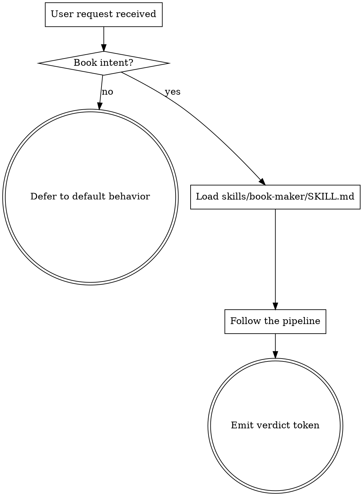

<!-- design-region-clean-of-hard-gates -->

# Using book-maker

<HARD-GATE>
Do NOT begin a book without invoking the book-maker skill at skills/book-maker/SKILL.md. STOP and load it.
</HARD-GATE>

<HARD-GATE>
Never produce a book from a single-pass write-up. STOP and route through the verified pipeline.
</HARD-GATE>

## Anti-Pattern

**"I can write this book inline without the full pipeline."** Inline write-ups skip claim verification, skip the narrative skeleton, and produce chapters that feel like isolated report sections. Route every book request through the full skill.

## Core Principle

Every book passes through the same verified pipeline with narrative architecture and adversarial continuity checking.

## Process Flow



## Checklist

1. Detect the book intent from the user's prompt.
2. Load `skills/book-maker/SKILL.md` and follow it without paraphrase.
3. Emit one of the four verdict tokens at exit.

## Step Details

### 1. Detect the book intent from the user's prompt

Trigger phrases include `/book-maker`, "write me a book on X", "build a book about X", "produce a non-fiction book", "generate a book on X", "create a book about X". Unclear prompts get one clarifying question, then load book-maker.

### 2. Load skills/book-maker/SKILL.md and follow it without paraphrase

book-maker carries the full pipeline. Read it before acting. Refuse to summarize the pipeline back to the user as a substitute for running it.

### 3. Emit one of the four verdict tokens at exit

`BOOK_SHIPPED` when the PDF rendered, every claim is verified, and all continuity gates passed. `CLAIMS_UNVERIFIED` when any load-bearing claim failed. `NARRATIVE_BROKEN` when continuity review failed after revision. `SCOPE_TOO_VAGUE` when the topic was rejected at the confirmation step.

## Gate Functions

- BEFORE answering a book request inline: "Did I load skills/book-maker/SKILL.md first?"
- BEFORE producing a PDF: "Did every load-bearing claim carry a `verified` verdict?"
- BEFORE summarizing the pipeline to the user: "Am I substituting prose for actually running the pipeline?"
- BEFORE emitting BOOK_SHIPPED: "Did all 8 continuity gates pass and did the PDF originate from the HTML renderer?"

## Rationalization Table

| You think... | Reality |
|---|---|
| "This topic is short, the inline answer is enough." | Dispatch every book request through book-maker. Inline answers skip the verifier and the narrative skeleton. |
| "I remember the pipeline, no need to load book-maker." | Load book-maker every time. Memory drifts; SKILL.md does not. |
| "I can paraphrase the steps to save tokens." | Run book-maker steps verbatim. Paraphrase is the source of skipped stages. |

## Red Flags

- "I remember the pipeline"
- "This one is fine inline"
- "Let me sketch the book first"
- "The user just wants a quick draft"

## Key Principles

- **Every book request routes through book-maker.** No inline write-ups.
- **Verdicts are one of four.** No improvised exit states.
- **book-maker's SKILL.md is the source of truth.** Memory is not.

## The Bottom Line

```bash
#!/usr/bin/env bash
set -euo pipefail
skill_path="${CLAUDE_PLUGIN_ROOT:-.}/skills/book-maker/SKILL.md"
if [[ ! -f "$skill_path" ]]; then
    echo "VERDICT: SCOPE_TOO_VAGUE"
    exit 1
fi
echo "loaded $skill_path"
echo "VERDICT: BOOK_SHIPPED"
```
